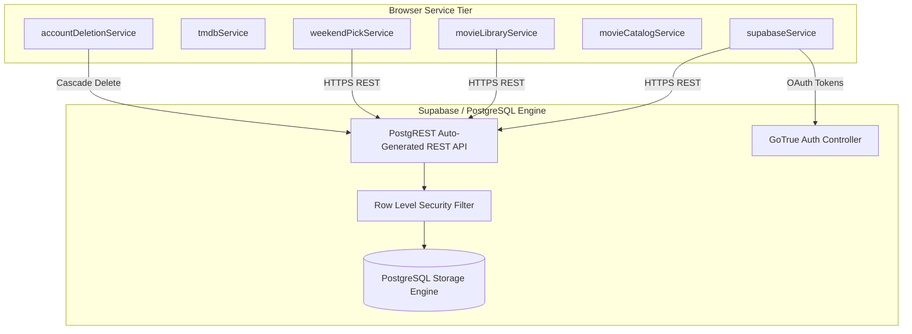

# BACKEND_ARCHITECTURE.md — Service Tier & PostgREST Contracts

## 1. Backend Architecture Pattern

CinemaScope operates on a **Decoupled Client-Side Service Layer interacting with PostgREST & Supabase Edge Services**. 

Rather than running a monolithic Express/FastAPI server for standard CRUD operations, PostgREST serves as a zero-maintenance, high-throughput RESTful bridge directly over the PostgreSQL schema. Application-specific workflows (such as TMDB caching, poster discovery, and consensus calculation) are isolated in domain service modules within `src/services/`.

---

## 2. Service Layer Modular Breakdown

### 2.1 `src/services/supabase.js`
- **Responsibilities**:
  - Initializes the `@supabase/supabase-js` client with session auto-refresh.
  - CRUD operations for movies, reviews, and collection entities.
  - Moderation operations (`updateReviewStatus`, `updateReviewReportCount`, `updateReviewLikes`).
  - Blacklist checks to ensure deleted users/movies never resurrect across devices.

### 2.2 `src/services/tmdbService.js`
- **Responsibilities**:
  - Connects to TMDB REST v3 endpoints (`/search/movie`, `/discover/movie`, `/movie/{id}`, `/watch/providers`).
  - Maintains an in-memory & `sessionStorage` cache to eliminate duplicate network calls.
  - Enriches theatrical entries with OTT streaming platforms and direct playback URLs.
  - Normalizes 10-point scale ratings into unified 5-star scales (`normalizeRating5`).

### 2.3 `src/services/weekendPickService.js`
- **Responsibilities**:
  - Manages weekly consensus voting rounds, candidate options, and winner declarations.
  - Synchronizes vote counts and round states with Supabase.
  - Manages real-time cross-tab events via `window.dispatchEvent('cinemascope_round_updated')`.

### 2.4 `src/services/movieLibraryService.js`
- **Responsibilities**:
  - Manages user watchlist, watched archive, and personal movie ratings.
  - Calculates CinemaScore gamification points based on activity (reviews authored, votes cast, films logged).
  - Synchronizes user profiles with community leaderboards.

### 2.5 `src/services/accountDeletionService.js`
- **Responsibilities**:
  - Executes privacy-compliant cascading data erasure across reviews, votes, watchlist records, and collections.
