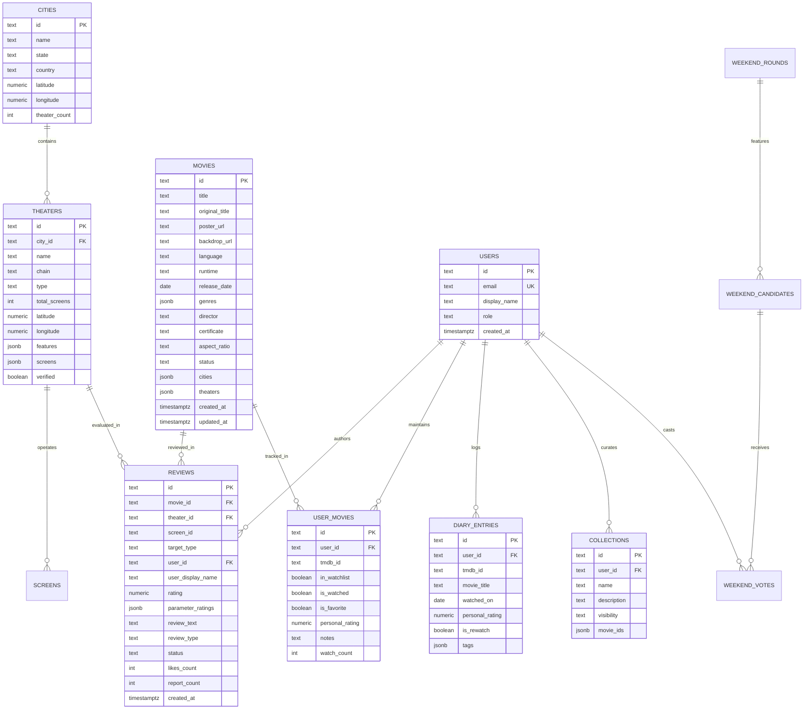

# DATABASE_ARCHITECTURE.md — Schema Design, ER Models & Indexing

## 1. Entity-Relationship (ER) Diagram



---

## 2. Table-by-Table Schema Specification

### 2.1 `public.movies`
- **Primary Key**: `id` (`TEXT`, supports standard IDs and `tmdb-{id}` slugs).
- **Core Columns**: `title` (`NOT NULL`), `release_date` (`DATE`), `status` (`CURRENTLY_SHOWING`, `COMING_SOON`, `ARCHIVED`).
- **Technical Specifications**: `aspect_ratio` (e.g., `2.39:1`, `1.90:1`, `1.43:1`), `runtime`, `trailer_url`.
- **JSONB Encodings**: `genres` (`["Action", "Sci-Fi"]`), `cast_list`, `cities`, `theaters`.

### 2.2 `public.reviews`
- **Primary Key**: `id` (`TEXT`).
- **Polymorphic Target**: Can evaluate a movie (`movie_id`), a theater (`theater_id`), or a specific screen (`screen_id`).
- **Multi-Parameter Ratings (`parameter_ratings`)**: JSONB storing visual quality, sound clarity, seating comfort, and moderation notices.
- **Moderation Attributes**: `likes_count` (`INT`), `report_count` (`INT`), `status` (`PUBLISHED`, `HIDDEN`, `FLAGGED`).

### 2.3 `public.user_movies`
- **Unique Constraint**: `UNIQUE(user_id, tmdb_id)` ensures idempotent tracking across devices.
- **Flags**: `in_watchlist`, `is_watched`, `is_favorite`.

---

## 3. Indexing Strategy for High Query Performance

The following indexes have been defined in `supabase-master-schema.sql` and `supabase-secure-rls.sql`:

```sql
-- Reviews Lookups
CREATE INDEX IF NOT EXISTS idx_reviews_movie_id ON public.reviews(movie_id);
CREATE INDEX IF NOT EXISTS idx_reviews_user_id ON public.reviews(user_id);
CREATE INDEX IF NOT EXISTS idx_reviews_theater_id ON public.reviews(theater_id);
CREATE INDEX IF NOT EXISTS idx_reviews_status_created ON public.reviews(status, created_at DESC);

-- Personal Library Lookups
CREATE INDEX IF NOT EXISTS idx_user_movies_user_id ON public.user_movies(user_id);
CREATE INDEX IF NOT EXISTS idx_user_movies_tmdb ON public.user_movies(user_id, tmdb_id);
CREATE INDEX IF NOT EXISTS idx_diary_entries_user_id ON public.diary_entries(user_id);
CREATE INDEX IF NOT EXISTS idx_diary_watched_on ON public.diary_entries(watched_on DESC);

-- Theaters & Cities
CREATE INDEX IF NOT EXISTS idx_theaters_city_id ON public.theaters(city_id);
CREATE INDEX IF NOT EXISTS idx_collections_user_id ON public.collections(user_id);
```

---

## 4. Backup & Disaster Recovery Strategy

1. **Logical Backups via `pg_dump`**:
   Execute daily compressed logical dumps of the schema and data:
   ```bash
   pg_dump -h db.example.com -U postgres -d postgres -F c -b -v -f /backups/cinemascope_$(date +%Y%m%d).dump
   ```
2. **Point-In-Time Recovery (PITR)**:
   For PostgreSQL instances, enable Write-Ahead Logging (WAL) archiving with a 7-day retention period, yielding a **Recovery Point Objective (RPO) of < 15 minutes** and a **Recovery Time Objective (RTO) of < 1 hour**.
