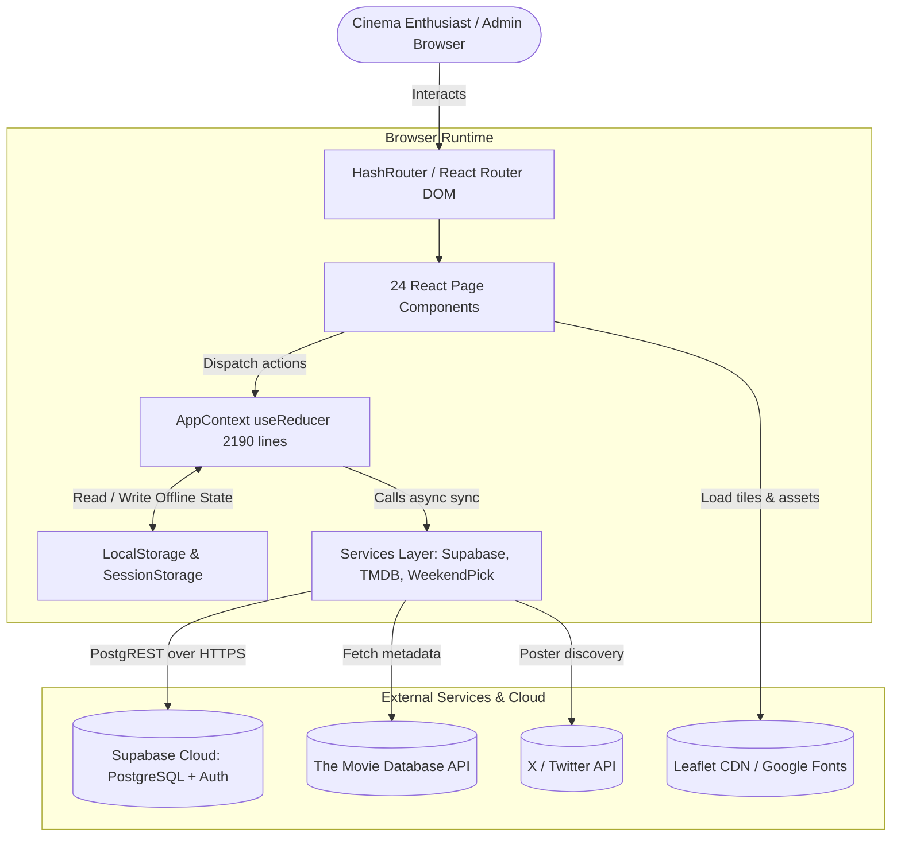

# EXISTING_ARCHITECTURE.md — Analysis of Baseline System

## 1. Architectural Style: Single Page Application (SPA) + Backend-as-a-Service (BaaS)

CinemaScope is currently structured as a client-centric Single-Page Application (SPA) connected directly to a Backend-as-a-Service (Supabase) via client-side REST/PostgREST interfaces. There is no custom backend application server (Node.js/Express, Python/FastAPI, or Go); all business logic, data merging, deduplication, and synchronization algorithms run directly inside the user's browser.



---

## 2. Component Organization & Hierarchy

The frontend follows a domain/feature directory pattern:
- **`src/components/layout/`**: Persistent shell components (`Navbar`, `MobileBottomNav`, `Footer`).
- **`src/components/movies/`**: Movie presentations (`MovieCard`, `GlobalMovieCard`, `OttReleasePopupModal`, `MovieCastCarousel`).
- **`src/components/theaters/` & `city/`**: Theater spec badges, interactive Leaflet theater map, screen selector.
- **`src/components/comparison/` & `simulator/`**: Dynamic aspect ratio visualizer (2.39:1 vs 1.90:1 vs 1.85:1) allowing film frame preview across custom screen ratios.
- **`src/components/reviews/`**: Multi-dimensional scoring cards (Aesthetics, Sound, Screen, Seating) with verified pro reviewer badging.
- **`src/components/weekend/`**: Voting cards, candidate submission modals, real-time vote count visualizers.
- **`src/components/admin/`**: Modals for TMDB auto-import, X poster scraping, and theater CRUD operations.

---

## 3. Data Flow & Synchronization Strategy

The application employs an **Optimistic UI + Bi-directional Storage Sync** strategy:

```mermaid
sequenceDiagram
    autonumber
    actor User
    participant View as React Page / Component
    participant Context as AppContext / Reducer
    participant Storage as LocalStorage
    participant Cloud as Supabase PostgREST

    User->>View: Add Review / Cast Vote / Change Status
    View->>Context: dispatch({ type: 'ADD_REVIEW', payload })
    Context->>Storage: saveStorage('cinemascope_reviews', updated)
    Note over Context,Storage: Instant UI update (Zero Latency)
    Context-->>View: State updated & rendered
    Context->>Cloud: supabaseService.saveReview(payload)
    alt Cloud Available
        Cloud-->>Context: HTTP 201 Created / 200 OK
    else Offline or Network Error
        Cloud--xContext: Network Error
        Note over Context: LocalStorage holds review; queued for next syncCloudData()
    end
```

---

## 4. Key Limitations of Existing Baseline Architecture

1. **State Monolith (`AppContext.jsx` ~2,190 LOC)**:
   A single god-context holds every domain entity (movies, reviews, users, theaters, cities, helpful votes, deletion requests, notifications, pro applications). A state update to one entity triggers re-evaluation across all consuming components.
2. **Component Monolith (`AdminDashboard.jsx` ~3,316 LOC)**:
   Contains movie editing, review moderation, user deletion, theater management, and weekend round administration within one massive file, making maintenance and testability difficult.
3. **Denormalized System Storage via `collections` Table**:
   The `collections` table was overloaded to store system metadata (e.g., `system_users_data`, `system_deleted_users`, `system_weekend_pick_data`, `system_deletion_requests`) as stringified JSON in the `description` column.
4. **Permissive Database Policies**:
   Baseline schema utilized `FOR ALL USING (true)`, delegating authorization checks entirely to client JavaScript.
5. **Client-Side Secret Exposure**:
   Supabase anon keys and TMDB API keys were previously hardcoded directly in client source files rather than managed via environment configurations.
