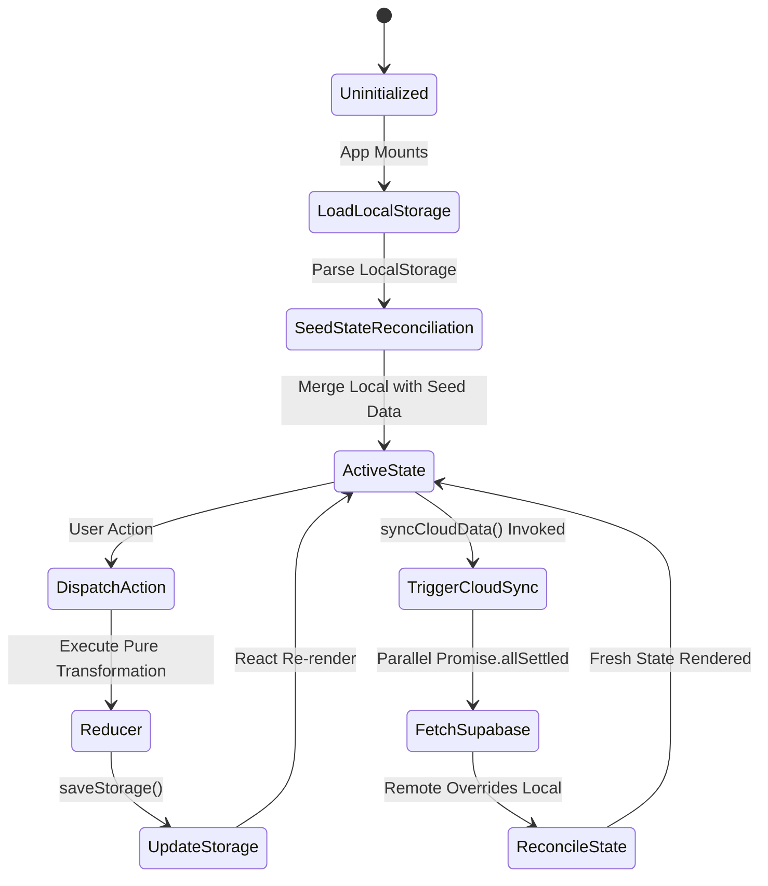

# FRONTEND_ARCHITECTURE.md — Client Framework & Component Architecture

## 1. Frontend Principles & Design Goals

1. **Reactivity with Zero Delay**: Optimistic UI updates ensure all user actions (favoriting, rating, voting) update the screen immediately without waiting for network roundtrips.
2. **Mobile-First Responsive Layout**: CinemaScope provides responsive experiences optimized for 360px mobile viewports through 4K desktop screens, with persistent top navigation and bottom navigation bars on mobile devices.
3. **Progressive Enhancement**: Critical content (theater specs, static film lists) renders without network access using local seed data.

---

## 2. Page & Route Architecture (`src/App.jsx`)

The routing topology is managed via `HashRouter` and partitioned into distinct domains:

```
/                             -> HomePage (Hero, Now Showing, Weekend Picks banner)
/movies                       -> MoviesPage (Search, Language, Format filters)
/movie/:movieId               -> MovieDetailPage (Aspect ratio specs, reviews, OTT)
/city/:cityId                 -> CityPage (Interactive Leaflet map, Multiplex directory)
/theater/:theaterId           -> TheaterPage (Screens overview, amenities, reviews)
/theater/:tId/screen/:sId     -> ScreenPage (Individual screen specs & simulator)
/compare                      -> ComparePage (Aspect ratio comparison slider)
/formats                      -> FormatsPage (Technical guide: IMAX vs Dolby vs 4K)
/weekend                      -> WeekendPickPage (Active community voting round)
/weekend-winners              -> WeekendWinnersArchivePage (Hall of Fame)
/library                      -> LibraryPage (Watchlist, Watched, Favorites)
/diary                        -> DiaryPage (Date-stamped cinema watch log)
/collection/:collectionId     -> CollectionPage (Curated movie lists)
/admin                        -> AdminDashboard (Catalog, Theaters, Moderation)
/profile / /profile/:userId   -> ProfilePage (Stats, badges, reviews)
/apply-professional           -> ProReviewerApplyPage (Critic certification)
/leaderboard                  -> LeaderboardPage (CinemaScore community rankings)
/users                        -> UserSearchPage (Discover fellow movie buffs)
```

---

## 3. State Management Lifecycle (`AppContext.jsx`)



---

## 4. UI Style System & Theming Tokens (`src/index.css`)

The UI is built on a custom design system using CSS custom properties:
- **Backgrounds**: `--bg-primary: #0a0a0c`, `--bg-card: #141419`, `--bg-elevated: #1e1e26`
- **Accents**: `--accent-gold: #e5a93c` (Cinema marquee gold), `--accent-crimson: #e50914`
- **Typography**: Inter (Variable font loaded via Google Fonts preconnect)
- **Spacings**: Strict 4px/8px modular grid
