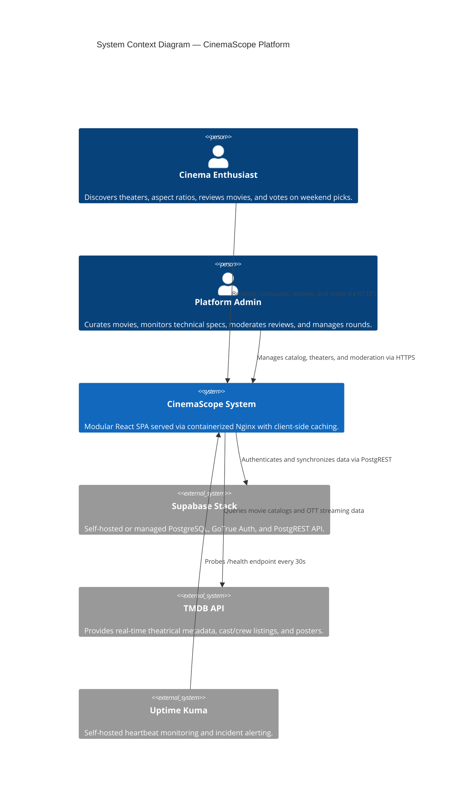
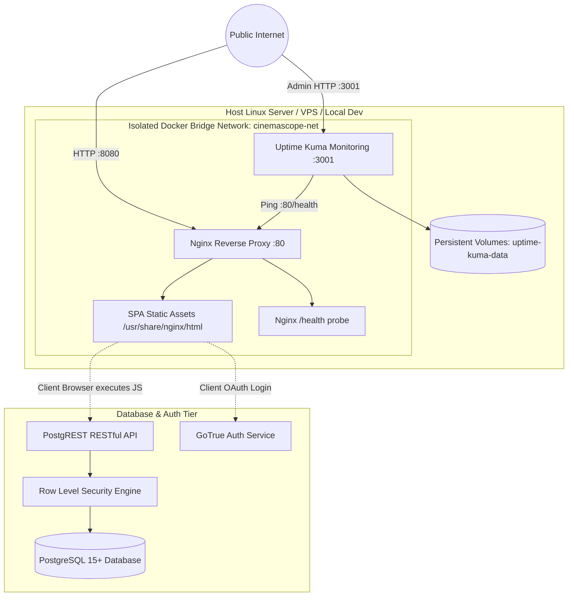
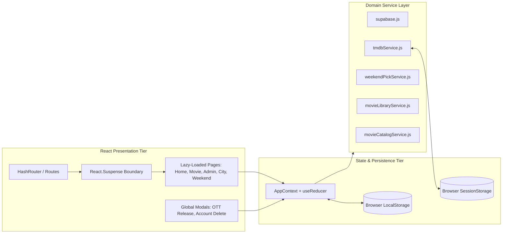
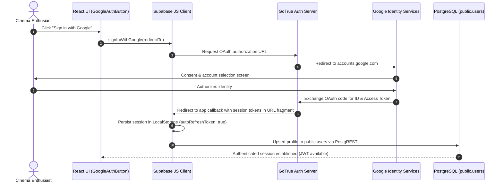

# SYSTEM_ARCHITECTURE.md — Target Production Architecture

## 1. Target Architecture Overview

The target architecture is a **Modular Single-Page Application (SPA) paired with a Containerized Edge Reverse Proxy (Nginx) and a Self-Hostable PostgreSQL/BaaS Backend (Supabase)**.

This model preserves the application's client-side reactivity and offline-first capabilities while adding containerization, environment security, database-level authorization, and self-hosted monitoring.

---

## 2. Container Architecture Diagram (Docker Compose Deployment)

---

## 3. Component Architecture & Data Flow

---

## 4. Authentication & Security Flow

---

## 5. Architectural Decision Rationale

### Why Monolithic SPA over Microservices?
1. **Zero Operational Overhead**: A team of 1–3 engineers can maintain, test, and deploy the entire platform in a single repository without Kubernetes clusters or distributed tracing complexity.
2. **Offline-First Resilience**: An SPA with LocalStorage caching ensures that even if backend connections drop, users can continue browsing theaters and cached film specs.
3. **Free & Open-Source Compatibility**: The entire stack runs on free, permissive open-source tools with zero proprietary lock-in.
